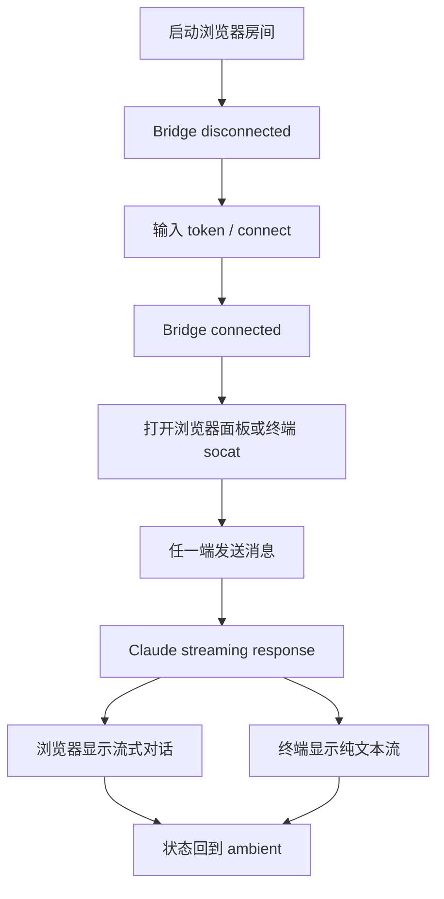

# LoFiClaude v1.1 - Dual Window Experience PRD

> 状态：Draft  
> 基于：v1.0 Terminal Companion、当前代码实现、现有 README/HANDOFF  
> 目标：让浏览器和终端真正像同一个 Claude 的两个窗口一样工作  
> 设计原则：**One Claude, two windows, one shared state.**

---

## 1. 概述

### 1.1 背景

v1.0 已经把终端和浏览器连到了同一个 Claude 会话上，但当前体验仍偏“可用”而不是“顺手”：

- 浏览器和终端的状态反馈还不够统一
- 连接、重连、断连、恢复的路径不够清晰
- 流式输出虽然存在，但对用户的感知不够稳定
- 双窗口同时输入时的边界行为需要明确
- 终端侧还缺少足够轻量、可扫一眼理解的可视反馈

### 1.2 产品概述

v1.1 不是新增一个新功能，而是把 v1.0 的桥接能力产品化，做成一个更完整的双窗协同体验：

- 浏览器负责氛围、可视化和结构化聊天
- 终端负责快速输入、原始工作流和低打扰交互
- 两端共享同一个 Claude session、同一份状态、同一条输出流

### 1.3 产品目标

业务目标：
- 提高 v1.0 的可感知完成度和稳定感
- 降低用户理解 bridge / socket / reconnect 的成本
- 让 LoFiClaude 在“浏览器 companion”之外具备“终端 companion”的独特记忆点

用户目标：
- 用户能一眼知道当前 Claude 是否在线、是否在工作、是否可输入
- 用户可以在浏览器和终端之间无缝切换
- 用户能清楚区分“谁发了消息、Claude 回给了谁、当前状态是什么”

### 1.4 目标用户

1. 本地 Claude Code / Codex CLI 用户
2. 喜欢终端输入、浏览器看结果的混合工作流用户
3. 需要低打扰氛围界面来辅助长时间编码的人

---

## 2. 产品描述

### 2.1 需求描述

当前 v1.0 的桥接能力已经完成，但产品还缺一个清晰的“两个窗口协作”的体验层。v1.1 需要补齐：

- 连接状态的统一表达
- 双端消息的可读性和归属感
- 断连/重连/恢复流程
- 双端同时输入的行为定义
- 终端侧的轻量状态反馈

### 2.2 主流程

### 2.3 版本规划

- v1.0：Terminal Companion 基础闭环
- v1.1：Dual Window Experience
- v1.2：可选增强，例如会话命令、历史标记、输出过滤、终端快捷操作

### 2.4 功能清单

1. 统一连接状态展示
2. 双窗消息归属展示
3. 流式输出稳定呈现
4. 重连与恢复机制
5. 双端同时输入规则
6. 终端侧轻量状态提示

---

## 3. 功能需求

### 3.1 统一连接状态

**描述**  
浏览器和终端都应明确展示当前 session 状态：`disconnected`、`connecting`、`connected`、`working`、`blocked`、`done`。

**用户故事**  
作为本地 Claude 用户，我希望知道当前会话是否可用，以便决定是继续输入还是先处理连接问题。

**交互要求**
- 浏览器顶部状态栏显示当前 bridge 状态
- 聊天面板显示当前 session 状态
- 终端输出包含简短状态行

**异常**
- token 错误：明确显示授权失败
- socket 不可用：提示 bridge 未启动
- Claude 退出：提示会话已结束，可重连

### 3.2 双窗消息归属

**描述**  
用户需要看懂消息是从浏览器发出还是从终端发出。

**用户故事**  
作为同时使用终端和浏览器的用户，我希望清楚消息来源，以便追踪上下文。

**交互要求**
- 浏览器消息显示 `You`
- 终端输入显示轻量来源标记，建议使用 `Terminal`
- Claude 回复在两端保持一致内容

### 3.3 流式输出

**描述**  
Claude 输出应保持真正的增量感，不等待完整答案结束。

**用户故事**  
作为长时间编码的用户，我希望看到 Claude 正在生成回复，以便判断它是在思考还是卡住。

**交互要求**
- 浏览器面板继续显示 streaming text
- Claude active message 实时追加
- 终端同步输出增量文本

### 3.4 重连与恢复

**描述**  
bridge 断开后，用户应能快速恢复会话，而不是重启整个房间。

**用户故事**  
作为经常切换终端状态的用户，我希望能快速重连，以便不中断工作。

**交互要求**
- 显示 reconnect 提示和按钮
- 保留最近会话上下文
- 重连成功后恢复到 connected 状态

### 3.5 双端同时输入

**描述**  
当浏览器和终端同时输入时，系统需要按顺序处理，不丢消息，不死锁。

**规则**
- 以到达 Claude 的顺序为准
- 输入展示要能区分来源
- 不做主动合并，不做隐式丢弃

---

## 4. 非功能需求

### 4.1 安全

- bridge token 继续作为唯一认证手段
- socket 文件权限维持 0600
- 不记录敏感 token 到日志

### 4.2 性能

- 流式输出延迟应尽可能接近实时
- UI 不因为长消息明显卡顿

### 4.3 稳定性

- bridge 异常退出后，前端必须能识别并提示
- socket 客户端断开不应影响主会话清理

---

## 5. 验收标准

1. 浏览器和终端都能看到同一个 Claude session 的输出
2. 任一端发送消息后，另一端也能看到回复流
3. 断连、重连、退出状态在两端都清楚可见
4. 双端同时输入不会让会话卡死
5. 用户无需理解内部协议就能完成操作

---

## 6. 待确认项

1. v1.1 的主入口是否继续以浏览器为主，还是要把终端提升为并列主入口
2. 终端侧是否需要更强的结构化标记，例如 tool / status / assistant 分段显示
3. 双端同时输入时，是否要做排队提示或仅靠自然顺序
4. 是否需要把 session 历史做成可恢复的本地缓存

