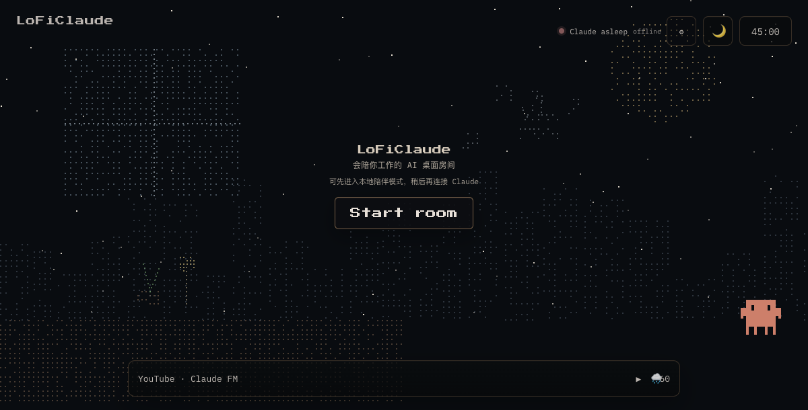

# LoFiClaude

一个本地优先的 AI 桌面房间：像素 Claude 陪你工作，播放 lofi 和雨声，并通过本地 Bridge 连接 Claude CLI。



> 先打开房间和环境音，需要 Claude 对话、终端接力或手机控制时，再启动 Bridge。

## 功能

- Svelte 5 + Vite 单页 ambient room
- 像素 Claude、场景切换、专注计时器和快捷键
- YouTube lofi 与本地雨声，浏览器自动播放遵循用户手势限制
- 本地 WebSocket Bridge，支持 Claude CLI 流式对话
- 浏览器、终端和手机共享同一个 Claude 会话
- 可选的网易云音乐本地播放与歌单搜索
- 手机扫码配对；凭据保存在本机 CLI 配置中，不写入网页

## 快速开始

需要 Node.js 18+。

```bash
npm install
npm run dev
```

打开 Vite 地址，点击 **Start room**。不启动 Bridge 也可以使用房间、环境音和本地陪伴功能。

## 连接 Claude CLI

在项目目录执行一次：

```bash
npm install --prefix bridge
npm link
```

启动 Bridge：

```bash
loficlaude bridge
```

然后在另一个终端进入同一会话：

```bash
loficlaude chat
```

网页、终端和已配对手机会共享上下文，不会启动第二个独立会话。Bridge 默认使用 `sonnet`，可通过 `LOFICLAUDE_MODEL` 修改；设置 `LOFICLAUDE_RESET_SESSION=1` 才会新建会话。

Bridge 只在本机监听：

- WebSocket：`ws://localhost:9120`
- 管理接口：`http://127.0.0.1:9121`

Bridge 通过一次性 token 认证。Claude CLI 以非交互文本模式启动，并关闭工具调用；它不能读取项目文件、编辑代码或执行 shell 命令。

## 手机配对

1. 启动 Bridge 和房间。
2. 打开 Bridge 设置，选择 **连接手机**。
3. 用 iPhone 相机或系统浏览器扫描二维码。

电脑和手机需要在同一个 Wi-Fi。访客网络隔离、错误的局域网网卡或 macOS 防火墙都可能导致连接失败。二维码地址使用 Bridge 的局域网 IP，不是 Vite 页面地址。

## 网易云音乐（可选）

```bash
loficlaude music setup
```

按 `ncm-cli` 向导完成配置和登录。登录信息由 `ncm-cli` 保存在本机；项目不会读取、提交或打包这些凭据。连接 Bridge 后，播放器控制本机的 NetEase Music/mpv；未连接时使用浏览器 lofi 播放器。

## 快捷键

| 按键 | 操作 |
| --- | --- |
| `Space` | 播放 / 暂停 |
| `←` / `→` | 上一首 / 下一首 |
| `↑` / `↓` | 调整雨声音量 |
| `M` | 静音雨声 |
| `1`–`6` | 切换场景 |
| `T` | 打开计时器 |
| `H` | 显示快捷键提示 |
| `Esc` | 关闭临时面板 |

## 开发与验证

```bash
npm test
npm run build
npm run verify:build
```

浏览器检查需要先启动房间：

```bash
npm run qa:browser
```

测试使用隔离的 Chromium 和测试 Bridge，不会调用真实 Claude 或 `ncm-cli`。

架构、产品文档和移动端配对说明见 [`docs/README.md`](docs/README.md)。历史 PRD、旧交接记录和原型资料保留在本地 `archive/`，不纳入 Git 版本控制；运行时动画预设已整理到 `src/canvas/claudepix_presets/`。

## 安全边界

仓库只包含源码、测试夹具和示例配置，不包含 API key、SSH 私钥、登录 cookie 或网易云凭据。Bridge token 仅用于本机连接；请只在可信的本地浏览器中使用。
