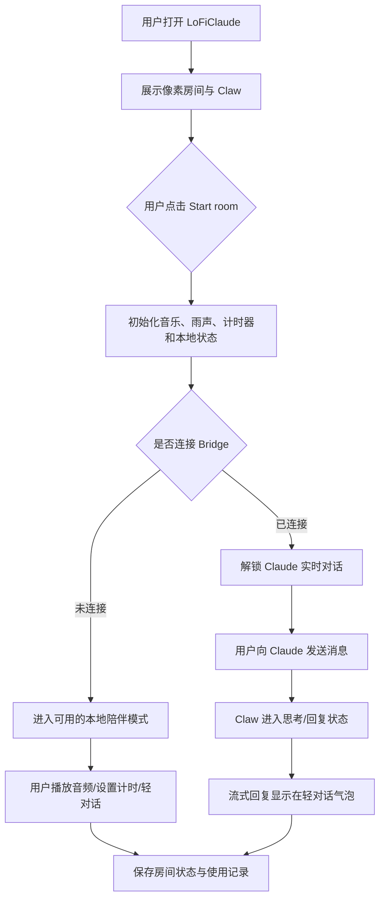
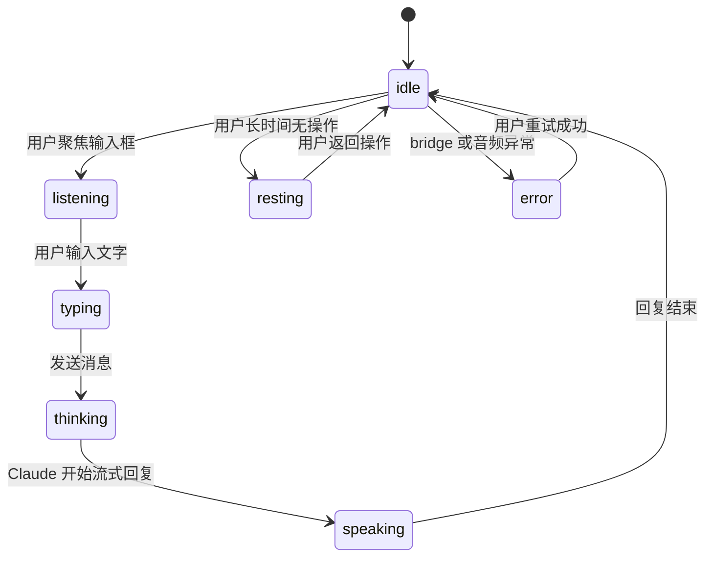
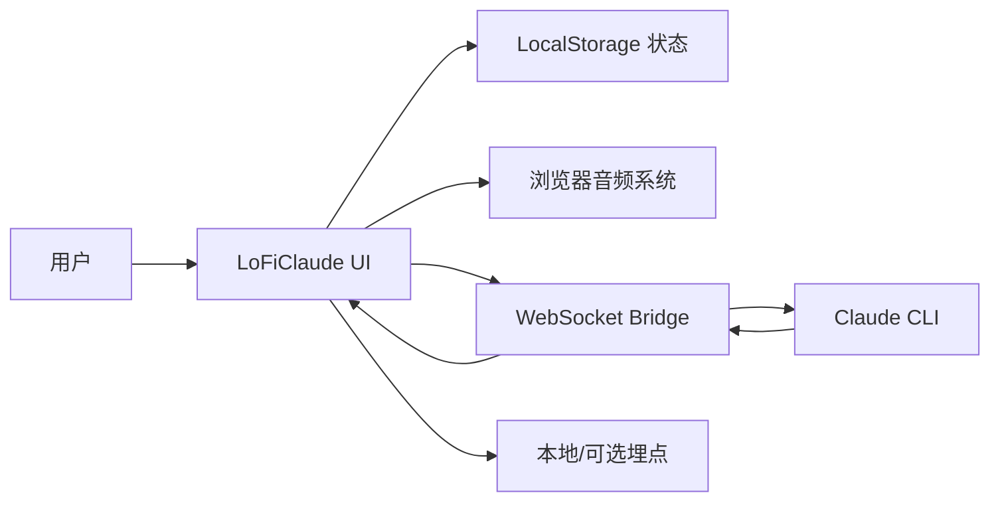
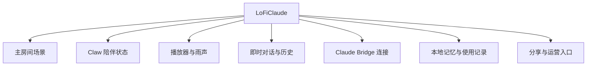
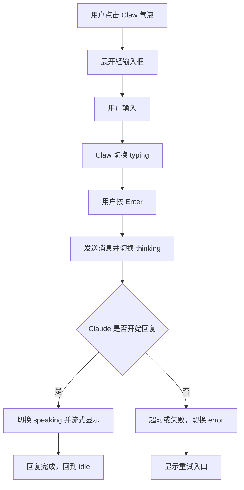

# LoFiClaude 产品需求文档（PRD）

版本号：V1.0.0

| 版本 | 时间 | 修订人 | 备注 |
|------|------|--------|------|
| V1.0.0 | 2026/07/15 | Codex | 基于 6 点产品缺口创建评审版 PRD |

## 一、概述（为什么做）

### 1.1 产品概述及目标

#### 1.1.1 背景介绍

LoFiClaude 当前已经具备像素房间、Claw/Claude 角色、lofi 音乐、雨声、计时器和 Claude bridge 对话能力，但产品仍更接近强氛围原型。下一阶段需要把视觉氛围、音频、AI 对话和使用留存组织成一个完整工作流，让用户愿意每天打开，而不是只觉得“好看”。

#### 1.1.2 产品概述

LoFiClaude 是一个会陪用户工作的 AI 桌面房间。用户进入房间后，可以播放 lofi 与雨声、设置专注计时、与 Claude 对话，并通过 Claw 的状态变化感知 AI 正在陪伴、思考、回复或休息。

#### 1.1.3 产品目标

**业务目标**

| 目标 | 指标 | 目标值 | 达成时间 |
|------|------|--------|----------|
| 提高复访意愿 | 7 日内二次打开率 | [待确认] MVP 内测用户 >= 35% | V1.0 上线后 2 周 |
| 提高核心功能触达 | Start room 后使用音频或对话的比例 | >= 70% | V1.0 上线后 2 周 |
| 降低启动挫败 | 首次进入到可用状态失败率 | < 10% | V1.0 上线后 2 周 |

**用户目标**

| 目标用户 | 用户目标 | 衡量指标 |
|----------|----------|----------|
| 使用 Claude CLI 的开发者 | 用更轻松的方式和 Claude 协作 | 成功连接 bridge 并完成一次对话 |
| 需要专注陪伴的创作者/学生 | 快速进入工作氛围 | Start room 后 10 秒内开始播放环境音 |
| 喜欢像素复古风的用户 | 获得有生命感的桌面陪伴 | Claw 状态能随行为变化 |

#### 1.1.4 目标用户

| 角色 | 描述 | 核心诉求 |
|------|------|----------|
| 专注工作用户 | 需要音乐、雨声、计时器辅助进入状态 | 打开即用、少打扰、氛围稳定 |
| Claude power user | 已安装或愿意使用 Claude CLI/bridge | 对话稳定、状态清楚、流式反馈 |
| 视觉氛围用户 | 被像素、复古、vaporwave 风格吸引 | 房间好看、角色有反应、可分享 |

### 1.2 名词说明

| 名词 | 说明 |
|------|------|
| Claw | 产品内的像素陪伴角色，用于承载 Claude 状态与陪伴反馈 |
| Room | 主界面的像素房间场景 |
| Bridge | 本地 WebSocket 服务，用于连接 Claude CLI |
| Session ritual | 用户进入房间后的固定启动仪式，例如 Start room、播放音频、开始计时 |

### 1.3 角色及权限

| 角色 | 权限范围 | 数据范围 |
|------|----------|----------|
| 本地用户 | 使用房间、音频、计时器、对话、历史记录 | 仅本地浏览器状态与本地 bridge |
| Bridge 服务 | 接收用户消息并转发到 Claude CLI | 当前本机 Claude 会话 |
| [待确认] 分享访问者 | 查看分享图或只读房间快照 | 分享者主动生成的数据 |

### 1.4 文档阅读对象

| 对象 | 关注内容 |
|------|----------|
| 产品 | 范围、优先级、验收标准 |
| UI/UX | 信息架构、角色状态、播放器布局 |
| 前端 | 状态机、音频、响应式、对话层级 |
| 测试 | 异常流程、浏览器 QA、音频 QA |
| 运营 | 复访、分享、使用数据 |

## 二、产品描述（做什么）

### 2.1 产品需求描述

本版本围绕 6 个核心缺口补齐产品闭环：

| # | 模块 | 目标 | 优先级 |
|---|------|------|--------|
| 1 | 产品主张 | 明确 LoFiClaude 是“会陪用户工作的 AI 桌面房间” | P0 |
| 2 | Claw 陪伴状态 | 让 Claw 随用户和 Claude 行为实时变化 | P0 |
| 3 | 音频体验 | 把 lofi、雨声、音量、计时器做成稳定核心体验 | P0 |
| 4 | 信息架构 | 拆清主场景、播放器、对话、历史、设置 | P0 |
| 5 | 新用户启动 | 降低 Start room、bridge、token 的理解成本 | P1 |
| 6 | 运营复访 | 增加专注记录、房间记忆、分享等复访抓手 | P1 |

不在本版本范围内：

- 不做云端账号系统。
- 不做多人协作房间。
- 不上传用户对话到远端服务。
- 不引入新的付费音乐源或未确认授权的打包音频。

### 2.2 产品整体流程

#### 2.2.1 主流程

#### 2.2.2 Claw 状态转换图

#### 2.2.3 数据流图

### 2.3 全局说明

#### 2.3.1 全局异常处理

| 异常场景 | 处理方式 | 提示文案 |
|----------|----------|----------|
| 浏览器阻止自动播放 | 保持静音状态，提示用户点击 Start room | 点击 Start room 开始房间 |
| 音乐源不可用 | 显示音频错误状态，允许重试或切歌 | 音乐暂时不可用，可以稍后重试 |
| 雨声源不可用 | 降级为本地生成雨声或静音 | 雨声连接失败，已切换备用模式 |
| Bridge 断开 | 对话输入禁用或切换本地轻陪伴模式 | Claude 连接断开，正在等待重连 |
| Claude 回复超时 | 结束 thinking 状态，允许重新发送 | Claude 暂时没有回应 |
| 窄屏布局 | 底部播放器保持居中，不出现横向滚动 | 无需提示 |

#### 2.3.2 全局交互

| 场景 | 交互方式 |
|------|----------|
| Start room | 一次点击同时初始化音频、场景、计时器、状态记忆 |
| 即时对话 | 点击 Claw 气泡后出现轻量输入，不遮挡 Claw |
| 历史对话 | 通过旁边菜单或抽屉打开，不替换即时气泡样式 |
| 设置面板 | 用独立入口展示音频、场景、bridge、外观设置 |
| 关闭弹层 | Esc 或点击外部关闭，不改变正在播放状态 |

### 2.4 产品版本规划

| 版本 | 范围 | 计划时间 | 状态 |
|------|------|----------|------|
| V1.0 | 6 点核心缺口补齐，形成可日用 MVP | [待确认] 1-2 周 | 规划中 |
| V1.1 | 分享图、房间自定义、更多 Claw 动作 | [待确认] | 规划中 |
| V2.0 | 云同步、跨设备、主题市场 | [待确认] | 远期 |

### 2.5 产品框架

### 2.6 功能清单

| 模块 | 功能 | 优先级 | 版本 | 说明 |
|------|------|--------|------|------|
| 产品主张 | 首屏文案和入口统一 | P0 | V1.0 | 明确“会陪你工作的 AI 桌面房间” |
| Claw 陪伴 | 行为状态机 | P0 | V1.0 | idle/listening/typing/thinking/speaking/resting/error |
| Claw 陪伴 | 动画和气泡反馈 | P0 | V1.0 | 不遮挡角色，不变成历史对话样式 |
| 音频体验 | lofi 播放器 | P0 | V1.0 | 播放/暂停/切歌/音量/错误状态 |
| 音频体验 | Rainy Mood 雨声 | P0 | V1.0 | 用户手势后播放，失败可降级 |
| 信息架构 | 历史对话抽屉 | P0 | V1.0 | 与即时对话分离 |
| 信息架构 | 底部播放器响应式居中 | P0 | V1.0 | 窄屏不偏移、不溢出 |
| 新用户启动 | Onboarding 状态提示 | P1 | V1.0 | 不连 bridge 也能可用 |
| 运营复访 | 今日专注记录 | P1 | V1.0 | 本地记录 session 时长 |
| 运营复访 | 分享截图入口 | P2 | V1.1 | 生成像素工作台分享图 |

## 三、功能需求（怎么做）

### 3.1 产品主张与首屏

#### 3.1.1 描述

统一产品定位，让用户在 5 秒内理解 LoFiClaude 是一个会陪自己工作的 AI 桌面房间。

#### 3.1.2 用户故事

作为首次访问用户，我希望一打开就知道这个房间能陪我工作，以便我愿意点击 Start room。

#### 3.1.3 前置条件

| 类型 | 条件 |
|------|------|
| 功能依赖 | 主房间可正常渲染 |
| 数据依赖 | 无 |

#### 3.1.4 后置条件

- 用户能理解 Start room 的用途。
- 用户能区分“本地陪伴模式”和“连接 Claude 模式”。

#### 3.1.5 界面及交互

| 元素 | 类型 | 必填 | 默认值 | 校验规则 | 操作反馈 |
|------|------|------|--------|----------|----------|
| 产品主标题 | 文本 | 是 | LoFiClaude | 不超过 24 字符 | 无 |
| 副文案 | 文本 | 是 | 会陪你工作的 AI 桌面房间 | 不超过 40 字符 | 无 |
| Start room | 主按钮 | 是 | 未启动 | 不可重复触发初始化 | 启动中显示 loading |
| Bridge 状态 | 状态标签 | 是 | disconnected | 根据连接状态更新 | 连接失败显示可重试 |

#### 3.1.6 异常/分支流程

| 场景 | 触发条件 | 处理方式 | 提示文案 |
|------|----------|----------|----------|
| 启动失败 | 音频或状态初始化异常 | 保持房间可见，允许重试 | 房间启动失败，请再试一次 |
| 不连接 bridge | 用户未填写 token 或未启动服务 | 进入本地陪伴模式 | 你可以先在本地房间里工作 |

#### 3.1.7 数据字典

| 字段名 | 类型 | 必填 | 说明 | 示例值 |
|--------|------|------|------|--------|
| room_started | Boolean | 是 | 房间是否已启动 | true |
| mode | Enum | 是 | local/bridge | bridge |
| bridge_status | Enum | 是 | disconnected/connecting/connected/error | connected |

### 3.2 Claw 陪伴状态系统

#### 3.2.1 描述

Claw 需要随用户和 Claude 行为变化，成为产品的情绪和状态反馈中心。

#### 3.2.2 用户故事

作为用户，我希望 Claw 能在我输入、等待、收到回复或离开时有不同状态，以便我感觉它真的在陪我工作。

#### 3.2.3 前置条件

| 类型 | 条件 |
|------|------|
| 功能依赖 | Claw sprite 或动态 HTML 素材可加载 |
| 功能依赖 | 对话输入、bridge 状态、音频状态可被监听 |

#### 3.2.4 后置条件

- Claw 状态随用户行为改变。
- 对话失败或连接断开时，Claw 显示错误/等待状态。

#### 3.2.5 界面及交互

| 元素 | 类型 | 必填 | 默认值 | 校验规则 | 操作反馈 |
|------|------|------|--------|----------|----------|
| Claw sprite | 动态视觉 | 是 | idle | 状态必须来自状态机 | 状态变化时切换动画 |
| 即时气泡 | 对话气泡 | 是 | 收起 | 不出现滚动条 | 点击 Claw 时展开 |
| 轻输入框 | 输入框 | 是 | 空 | Enter 发送，Shift+Enter 换行 | 发送后保持轻气泡样式 |
| 历史菜单按钮 | 图标按钮 | 是 | 收起 | 不遮挡 Claw | 点击打开历史抽屉 |

#### 3.2.6 业务流程

#### 3.2.7 异常/分支流程

| 场景 | 触发条件 | 处理方式 | 提示文案 |
|------|----------|----------|----------|
| 发送失败 | bridge 断开或超时 | 保留用户输入，允许重试 | Claude 没接住这句话 |
| 气泡遮挡 Claw | 视口过窄或定位冲突 | 气泡自动移到 Claw 上方/侧边安全区 | 无 |
| 回复过长 | Claude 输出超过气泡容量 | 气泡显示最新摘要，历史抽屉保留完整内容 | 完整内容在历史里 |

#### 3.2.8 数据字典

| 字段名 | 类型 | 必填 | 说明 | 示例值 |
|--------|------|------|------|--------|
| companion_state | Enum | 是 | idle/listening/typing/thinking/speaking/resting/error | thinking |
| last_user_activity_at | DateTime | 是 | 最近用户操作时间 | 2026-07-15 08:30:00 |
| bubble_open | Boolean | 是 | 即时气泡是否展开 | true |
| active_message_id | String | 否 | 当前正在回复的消息 ID | msg_001 |

### 3.3 音频体验系统

#### 3.3.1 描述

把 lofi 音乐、雨声、音量、计时器和播放错误处理做成可靠的核心体验。

#### 3.3.2 用户故事

作为专注工作用户，我希望点击 Start room 后音乐和雨声稳定可控，以便我不用反复调试音频。

#### 3.3.3 前置条件

| 类型 | 条件 |
|------|------|
| 功能依赖 | 浏览器支持 HTMLAudioElement 或 YouTube iframe |
| 外部依赖 | 第三方音频源可访问 |
| 合规依赖 | [待确认] Rainy Mood 热链和音乐源使用授权 |

#### 3.3.4 后置条件

- 用户可以播放/暂停 lofi。
- 用户可以调节雨声音量和强度。
- 音频失败时不会导致房间不可用。

#### 3.3.5 界面及交互

| 元素 | 类型 | 必填 | 默认值 | 校验规则 | 操作反馈 |
|------|------|------|--------|----------|----------|
| 播放/暂停 | 图标按钮 | 是 | paused | 仅用户手势后触发 | 状态图标变化 |
| 雨声音量 | Slider | 是 | 55 | 0-100 | 实时调整音量 |
| 雨声强度 | 分段控制 | 是 | medium | light/medium/heavy | 切换后淡入 |
| 计时器 | 弹层/控制器 | 是 | off | 最小 1 分钟 | 结束时 4 秒淡出 |
| 播放器容器 | 底部工具条 | 是 | 居中 | 窄屏不横向溢出 | 自适应宽度 |

#### 3.3.6 异常/分支流程

| 场景 | 触发条件 | 处理方式 | 提示文案 |
|------|----------|----------|----------|
| 自动播放被阻止 | 未经过用户手势 | 等待 Start room | 点击 Start room 开始声音 |
| 雨声加载失败 | 第三方源错误 | 使用 fallback 或静音保底 | 雨声暂时不可用 |
| YouTube iframe 超时 | API 未 ready | 重试一次，仍失败则提示 | 音乐连接超时 |
| 计时结束 | 倒计时归零 | 音频 4 秒淡出，可重新开始 | 专注结束了 |

#### 3.3.7 数据字典

| 字段名 | 类型 | 必填 | 说明 | 示例值 |
|--------|------|------|------|--------|
| music_status | Enum | 是 | idle/loading/playing/paused/error | playing |
| rain_volume | Number | 是 | 雨声音量 0-100 | 55 |
| rain_intensity | Enum | 是 | light/medium/heavy | medium |
| timer_remaining_ms | Number | 否 | 计时器剩余毫秒 | 1500000 |
| audio_error_code | String | 否 | 最近音频错误码 | youtube_ready_timeout |

### 3.4 信息架构与布局

#### 3.4.1 描述

把主场景、播放器、即时对话、历史对话和设置拆清楚，避免层级混乱。

#### 3.4.2 用户故事

作为用户，我希望即时对话不会突然变成历史面板，播放器在任何宽度都居中，以便界面稳定且不打断工作。

#### 3.4.3 前置条件

| 类型 | 条件 |
|------|------|
| 功能依赖 | 现有组件可拆分为主场景、播放器、对话抽屉 |

#### 3.4.4 后置条件

- 即时对话和历史对话拥有独立入口。
- 底部播放器在桌面和窄屏都居中。
- 弹层不遮挡 Claw 主体。

#### 3.4.5 界面及交互

| 元素 | 类型 | 必填 | 默认值 | 校验规则 | 操作反馈 |
|------|------|------|--------|----------|----------|
| 主场景 | 全屏区域 | 是 | 显示房间 | 不被工具条遮挡核心角色 | 响应视口变化 |
| 底部播放器 | 工具条 | 是 | 居中 | max-width + width: calc | 窄屏仍居中 |
| 即时气泡 | 浮层 | 是 | 收起 | 不出现滚动条 | 内容超长折叠摘要 |
| 历史抽屉 | 侧边菜单 | 是 | 收起 | 不自动打开 | 点击历史按钮打开 |
| 设置入口 | 图标按钮 | 是 | 收起 | 与历史入口区分 | 打开设置弹层 |

#### 3.4.6 异常/分支流程

| 场景 | 触发条件 | 处理方式 | 提示文案 |
|------|----------|----------|----------|
| 窄屏宽度不足 | 视口 < 480px | 播放器缩小并保持居中，按钮不换位遮挡 | 无 |
| 对话内容过长 | 单条回复过长 | 即时气泡只显示当前回复摘要，完整内容进历史 | 完整内容在历史里 |
| 多弹层冲突 | 历史和设置同时打开 | 新弹层打开时关闭旧弹层 | 无 |

#### 3.4.7 数据字典

| 字段名 | 类型 | 必填 | 说明 | 示例值 |
|--------|------|------|------|--------|
| drawer_open | Enum | 是 | none/history/settings/timer/rain/scene | history |
| viewport_mode | Enum | 是 | mobile/tablet/desktop | mobile |
| player_layout | Enum | 是 | compact/expanded | compact |

### 3.5 新用户启动与连接引导

#### 3.5.1 描述

降低首次使用门槛，让不连接 Claude bridge 的用户也能先进入房间。

#### 3.5.2 用户故事

作为首次访问用户，我希望不用理解所有技术配置也能开始使用，以便我先体验房间氛围。

#### 3.5.3 前置条件

| 类型 | 条件 |
|------|------|
| 功能依赖 | 本地陪伴模式可用 |
| 功能依赖 | Bridge 状态可检测 |

#### 3.5.4 后置条件

- 未连接 bridge 时，房间仍可播放音频和显示本地陪伴提示。
- 需要 Claude 实时对话时，用户能看到清楚的连接步骤。

#### 3.5.5 界面及交互

| 元素 | 类型 | 必填 | 默认值 | 校验规则 | 操作反馈 |
|------|------|------|--------|----------|----------|
| Start room | 主按钮 | 是 | 可点击 | 初始化中禁用重复点击 | 成功进入房间 |
| Connect Claude | 次按钮/设置项 | 是 | 未连接 | token 为空时不可提交 | 连接中显示状态 |
| Token 输入 | 密码输入框 | 否 | 空 | 不在日志中输出 | 错误时只提示失败 |
| 本地模式提示 | 状态文案 | 是 | 可用 | 不阻塞主流程 | 告知可稍后连接 |

#### 3.5.6 异常/分支流程

| 场景 | 触发条件 | 处理方式 | 提示文案 |
|------|----------|----------|----------|
| token 错误 | bridge 拒绝连接 | 保持 token 输入，允许重试 | Token 不正确 |
| bridge 未启动 | WebSocket 连接失败 | 展示启动指引 | 本地 bridge 没有启动 |
| 用户跳过连接 | 点击关闭或不输入 token | 进入本地模式 | 你可以稍后连接 Claude |

#### 3.5.7 数据字典

| 字段名 | 类型 | 必填 | 说明 | 示例值 |
|--------|------|------|------|--------|
| onboarding_seen | Boolean | 是 | 是否看过启动引导 | true |
| bridge_token_saved | Boolean | 是 | 是否存在本地 token | false |
| connect_attempt_count | Number | 是 | 本次连接尝试次数 | 1 |

### 3.6 运营复访与分享

#### 3.6.1 描述

增加轻量复访抓手，让用户形成“打开房间开始工作”的习惯。

#### 3.6.2 用户故事

作为长期用户，我希望房间能记住我的音乐、雨声和专注记录，以便下次打开时快速进入状态。

#### 3.6.3 前置条件

| 类型 | 条件 |
|------|------|
| 数据依赖 | 可使用 LocalStorage 或 IndexedDB 保存本地状态 |
| 合规依赖 | 不保存敏感对话到远端 |

#### 3.6.4 后置条件

- 用户下次打开时恢复上次音频和场景偏好。
- 用户可以看到今日专注时长。
- [待确认] 用户可以生成分享图。

#### 3.6.5 界面及交互

| 元素 | 类型 | 必填 | 默认值 | 校验规则 | 操作反馈 |
|------|------|------|--------|----------|----------|
| 今日专注 | 文本/计数 | 是 | 0 min | 只统计 Start room 后活跃时长 | 每分钟更新 |
| 房间记忆 | 本地状态 | 是 | 默认场景 | 不跨设备 | 下次自动恢复 |
| 陪伴语录 | 文本 | 否 | 无 | 不展示敏感对话内容 | 每 session 生成一次 |
| 分享截图 | 图标按钮 | 否 | 隐藏 | [待确认] V1.1 开启 | 生成后可保存图片 |

#### 3.6.6 异常/分支流程

| 场景 | 触发条件 | 处理方式 | 提示文案 |
|------|----------|----------|----------|
| 本地存储不可用 | 浏览器禁用存储 | 当前 session 可用，不保存记忆 | 这次不会保存房间状态 |
| 分享生成失败 | Canvas 或资源跨域限制 | 显示失败并允许重试 | 分享图生成失败 |
| 用户清除数据 | 点击重置本地状态 | 二次确认后清空本地偏好 | 已重置房间记忆 |

#### 3.6.7 数据字典

| 字段名 | 类型 | 必填 | 说明 | 示例值 |
|--------|------|------|------|--------|
| daily_focus_minutes | Number | 是 | 今日专注分钟数 | 42 |
| last_scene_id | String | 是 | 上次使用场景 | vapor_xp |
| last_music_volume | Number | 是 | 上次音乐音量 0-100 | 60 |
| last_rain_volume | Number | 是 | 上次雨声音量 0-100 | 55 |
| streak_days | Number | 否 | 连续使用天数 | 3 |

## 四、非功能需求（注意事项）

### 4.1 安全与合规需求

| 需求 | 说明 |
|------|------|
| Token 安全 | bridge token 不得出现在日志、URL、截图分享数据或错误上报中 |
| 对话隐私 | 默认不上传对话到第三方分析服务；历史记录仅本地保存 |
| 音频合规 | Rainy Mood 和 lofi 来源需要确认授权与 hotlink 条款 |
| 外部依赖降级 | 第三方音频、YouTube、bridge 不可用时，房间仍可进入 |

### 4.2 统计需求（埋点）

| 事件名 | 触发时机 | 属性 | 说明 |
|--------|----------|------|------|
| room_start | 用户点击 Start room 成功 | mode, viewport_mode | 房间启动 |
| audio_play | 音乐或雨声开始播放 | audio_type, source, volume | 音频使用 |
| audio_error | 音频初始化或播放失败 | audio_type, error_code | 音频稳定性 |
| companion_state_change | Claw 状态变化 | from_state, to_state, reason | 陪伴状态质量 |
| chat_send | 用户发送消息 | mode, bridge_status | 对话触达 |
| bridge_connect_result | bridge 连接成功或失败 | result, error_code | 连接漏斗 |
| focus_session_end | 专注 session 结束 | duration_minutes, ended_by | 留存与使用强度 |

### 4.3 性能需求

| 指标 | 要求 |
|------|------|
| 首屏渲染 | 本地开发环境首次加载 < 2s，[待确认] 生产环境 < 3s |
| Start room 响应 | 点击后 300ms 内出现启动反馈 |
| 动画性能 | 常规桌面浏览器保持 50fps 以上 |
| 音频初始化 | 成功或失败反馈在 5s 内给出 |
| 布局稳定 | 播放器、气泡、抽屉打开时 CLS 接近 0 |

### 4.4 数据库设计

V1.0 不引入服务端数据库。以下数据使用浏览器本地存储：

| 数据 | 存储位置 | 生命周期 | 清理策略 |
|------|----------|----------|----------|
| 房间偏好 | LocalStorage | 长期 | 用户手动重置 |
| 今日专注 | LocalStorage | 当日 | 跨日归档或重置 |
| 历史对话 | [待确认] LocalStorage/IndexedDB | [待确认] 默认 7 天 | 超出条数或时间后清理 |
| bridge token | [待确认] LocalStorage 或仅 session | 用户选择 | 用户手动删除 |

### 4.5 系统集成

| 对接系统 | 接口方向 | 协议 | 说明 |
|----------|----------|------|------|
| Claude Bridge | 前端调用 | WebSocket | 连接本地 Claude CLI |
| Claude CLI | bridge 调用 | 本地进程 | 负责真实 Claude 对话 |
| YouTube | 前端加载 | iframe API | lofi 播放来源之一 |
| Rainy Mood | 前端加载 | HTTPS 音频 | 雨声来源，[待确认] 授权 |

## 五、附录

### 5.1 验收标准与测试要点

| 功能 | 验收条件 | 优先级 |
|------|----------|--------|
| 产品主张 | 首屏 5 秒内能识别产品用途和 Start room 入口 | P0 |
| Claw 状态 | 输入、发送、思考、回复、断线至少 5 种状态可复现 | P0 |
| 即时对话 | 点击 Claw 气泡发送消息后，不切换成历史对话样式 | P0 |
| 历史对话 | 点击历史菜单后打开历史抽屉，关闭后回到主场景 | P0 |
| 播放器布局 | 1440px、768px、390px 宽度下底部播放器水平居中且无横向溢出 | P0 |
| 音频播放 | Start room 后 lofi 和雨声可播放、暂停、调音量 | P0 |
| 音频异常 | 阻断雨声或 YouTube 后，界面给出错误/降级状态且不崩溃 | P0 |
| Bridge 连接 | token 正确时可连接并流式回复，错误时提示可重试 | P1 |
| 本地模式 | 未启动 bridge 时，仍可播放音频和使用本地陪伴提示 | P1 |
| 专注记录 | Start room 后累计今日专注时长，刷新后保留 | P1 |
| 安全 | token 不出现在 console、URL、埋点属性、分享图数据中 | P0 |

### 5.2 待确认项清单

#### 必须确认（阻塞开发）

1. [待确认] Rainy Mood 热链和 lofi 音乐源是否允许当前使用方式。
2. [待确认] bridge token 是否长期保存，还是只在 session 内保存。
3. [待确认] 历史对话保存周期、保存位置和默认条数。

#### 建议确认（影响完整度）

4. [待确认] V1.0 的目标用户优先级：开发者优先，还是专注陪伴用户优先。
5. [待确认] V1.0 是否包含分享截图，还是放入 V1.1。
6. [待确认] 今日专注时长是否只统计计时器，还是统计 Start room 后活跃时间。

#### 可后续补充

7. [待确认] 是否需要多套 Claw 皮肤或房间主题。
8. [待确认] 是否需要公开落地页，而不是直接进入产品界面。
