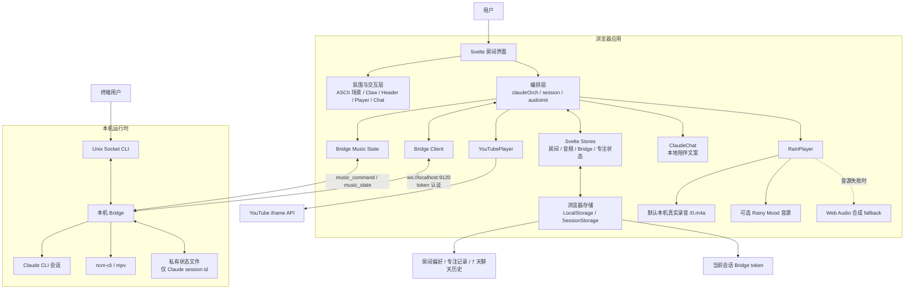

# LoFiClaude 产品架构

## 边界

- 浏览器负责呈现、状态编排、音频控制和本地持久化。
- Bridge 只在本机监听，验证 token 后转发浏览器或 Unix Socket 消息。
- Claude CLI 是实际的流式文本对话会话，使用 `--permission-mode dontAsk --tools ""`，不能读取、修改文件或执行命令。Bridge 离线时房间和本地陪伴仍可使用。
- Bridge 独立以保守规则预解析音乐请求，通过 `execFile` 和固定参数白名单调用本机 `ncm-cli`，不是 Claude tool calling。音乐执行失败不得中断 Claude 文本回复。
- 默认雨声为项目内真实录音 `/0.m4a`；Rainy Mood 是可选远端源；加载失败才使用 Web Audio 合成 fallback。公开发布前仍需确认录音与可选远端源授权。
- Bridge token 每个服务进程轮换，只在当前浏览器 SessionStorage 保存；聊天历史只存入 LocalStorage，不进入第三方请求参数。

## 场景目录

`src/canvas/asciiScenes.js` 是场景 key、名称、菜单标签、图标、对象布局和粒子配置的唯一目录。
Header、ScenePopover、持久化和轮换顺序均从目录读取；`appPersistence.js` 保留原有导出以兼容调用方。
`ambientParticles.js` 按场景声明创建效果，不再另外维护场景 key 白名单。未知 key（包括继承属性名）统一回退到 `lofiNight`。
本轮保持现有对象布局与 Canvas 路径，不增加依赖或自动更改音频来源。
静态场景仅在初始化、调整尺寸和换景渐变时绘制；稳定状态不再逐帧复制背景。粒子继续独立以最高约 30fps 更新，隐藏页面/降低动态模式遵循原有暂停策略。

## 状态所有权

- Claude 会话、播放状态属于本机 Bridge；连接的浏览器共享当前播放器。
- 搜索候选与待选择动作属于发起请求的连接，不广播、不进入重放历史，断开即失效。
- 终端 socket 的文本继续进入共享 Claude session，但不复用浏览器候选；音乐控制走浏览器固定白名单路径。
- 当前执行状态只以根目录 `HANDOFF.md` / `TODO.md` 为准；产品计划中的远期能力不等于本轮已完成项。
- `musicFeedback.js` 维护候选和操作反馈，Claude delta/idle 不修改它；音乐错误使用独立 `music_error` 事件。
- `recentPlaylist.js` 仅在确认播放后保存 `{ id, originalId, name }` 到本机 LocalStorage。刷新不发播放命令；点击恢复通过受限 `play_playlist` 协议交给 controller 再校验。
- `audioInit` 在手势后初始化，并根据当前连接避免 YouTube 与本机播放器竞争；Clawd 音乐完成动作不打断正在输入/流式回复，也不改写已完成文本。
