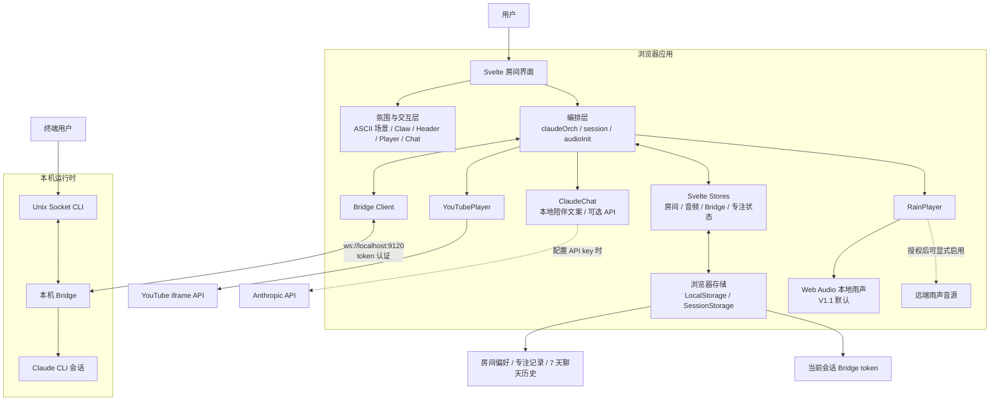

# LoFiClaude 产品架构

## 边界

- 浏览器负责呈现、状态编排、音频控制和本地持久化。
- Bridge 只在本机监听，验证 token 后转发浏览器或 Unix Socket 消息。
- Claude CLI 是实际的流式工作会话；Bridge 离线时房间和本地陪伴仍可使用。
- V1.1 默认使用本地 Web Audio 雨声，避免未确认授权的远端热链成为发布依赖。
- Bridge token 只存入 SessionStorage；聊天历史只存入 LocalStorage，不进入第三方请求参数。
