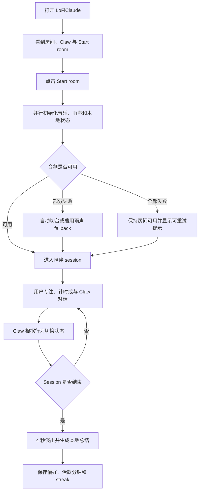
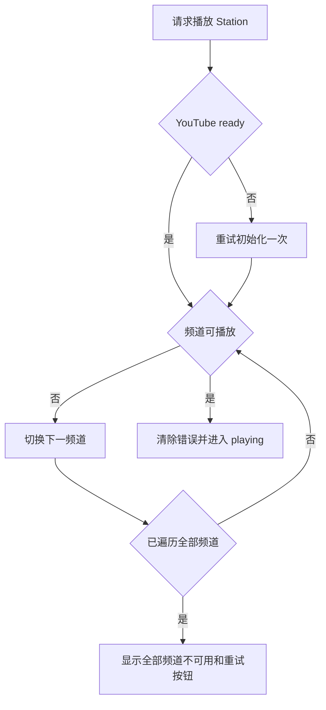
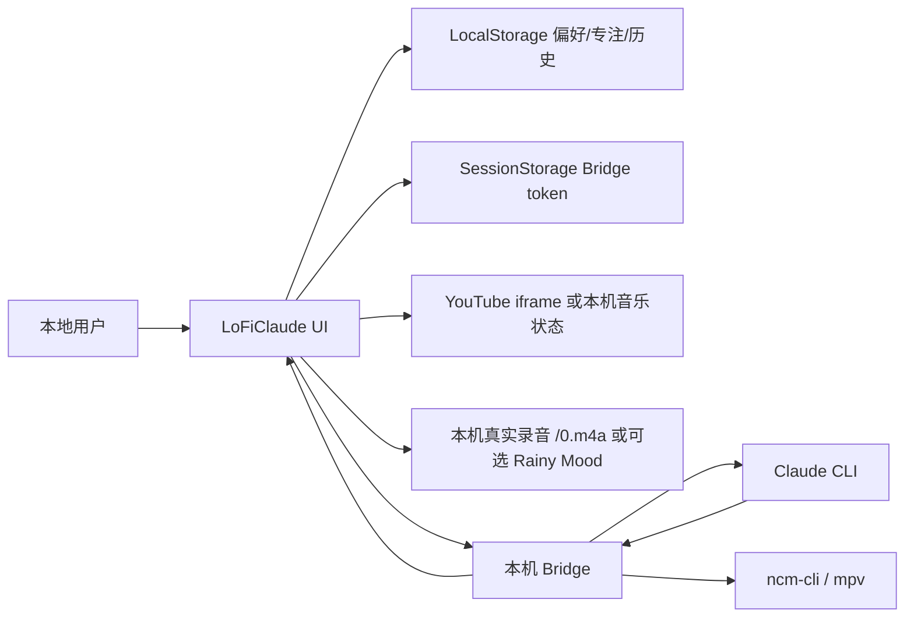
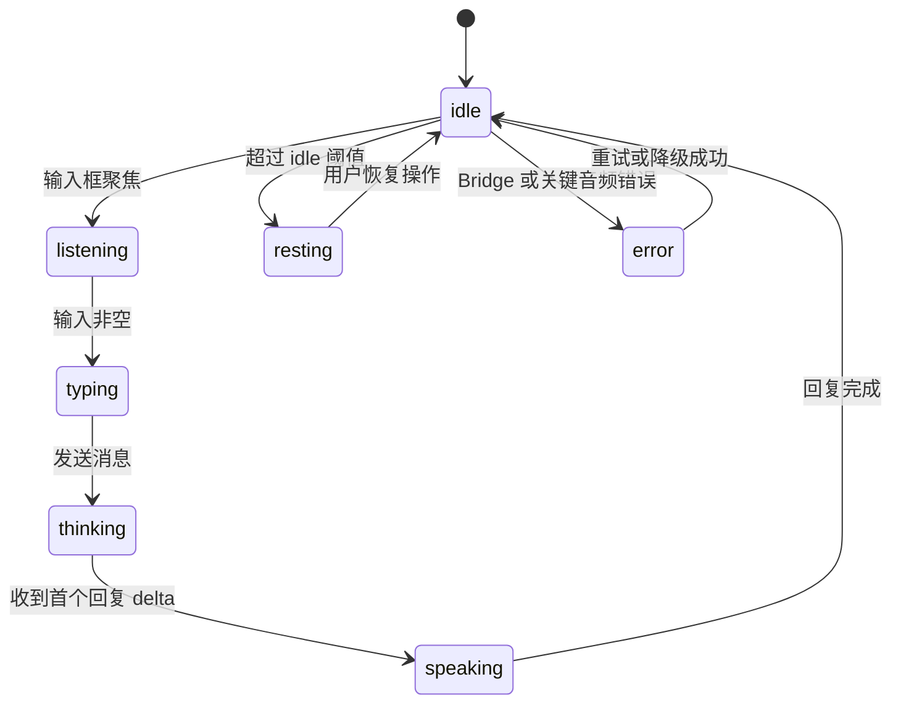
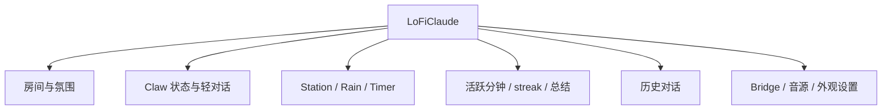

# LoFiClaude 产品需求文档（PRD）

版本号：V1.1.0

状态：V1.1 产品契约；当前 P0/P1/P2 执行与验收状态以根目录 HANDOFF.md / TODO.md 为准，不以历史完成声明代替验收。

| 版本 | 时间 | 修订人 | 备注 |
|------|------|--------|------|
| V1.1.0 | 2026/07/15 | Codex | 基于 V1.0 实现 review、浏览器 QA 与 lofi.cafe 调研形成可靠性增强版 |
| V1.1.0 | 2026/07/27 | Codex | 同步实现状态，确认本地雨声、SessionStorage token 与 7 天历史策略 |

当前发布决策：LoFiClaude 是氛围感 lofi 播放器，Claw 陪伴和 Claude 连续对话是增强层。V1.1 在用户手势后启用 YouTube lofi；连接本机 Bridge 且配置 ncm-cli 时，播放器优先控制本机网易云/mpv。默认雨声为项目内 `public/0.m4a`，Rainy Mood 为可选远端来源；任一音乐 provider 失败都不影响雨声，音乐状态必须与雨声状态独立展示。

本轮音乐契约：Bridge 保守规则识别浏览器音乐请求，Claude 保持文本会话（`--permission-mode dontAsk --tools ""`）；终端输入只续接文本，不复用浏览器歌单候选。候选为连接私有，重连后重新搜索。气泡独立展示 5 个以内候选及操作状态，不覆盖回复。确认播放后仅将歌单 ID/名称保存在本机 LocalStorage；刷新不自动播放，点击最近歌单才恢复。场景目录统一在 `src/canvas/asciiScenes.js`。不使用远端 CI；真实听音、Safari/Firefox/真机由用户验收。

## 一、概述（为什么做）

### 1.1 产品概述及目标

#### 1.1.1 背景介绍

LoFiClaude 已具备像素房间、Claw 陪伴角色、YouTube lofi、雨声、专注计时、本地陪伴和 Claude Bridge 对话能力。V1.0 已从视觉原型进入可操作产品阶段，但本轮 review 和浏览器 QA 暴露出以下阻塞日用的问题：

- 音频失败后的恢复链路不完整，雨声 fallback 可能显示成功但实际无声。
- 雨声 light/medium/heavy 在远端音源下没有真实差异。
- Claw 的状态文案会被历史回复覆盖，多种状态共用同一视觉，陪伴感不足。
- 今日专注会在后台或休息状态继续累计，连续使用天数存在首日偏差。
- 启动后画面过暗、主场景空旷，Claw 和主要控制的视觉优先级不足。
- Bridge 配置长期占据主界面，产品更像开发调试工具，而不是陪伴房间。
- Rainy Mood 热链与 YouTube 频道继续遵循显式降级边界；Bridge token 的本机启动展示策略已确认。

lofi.cafe 调研显示，其核心不是独立音乐 API，而是“全屏动态内容 + YouTube 直播台目录 + 一次点击启动 + 极少控制”。V1.1 借鉴其低操作负担和内容优先原则，不复制其视觉素材、代码或未经授权确认的频道清单。

#### 1.1.2 产品概述

LoFiClaude 是一个会感知用户和 Claude 工作状态的本地 AI 专注房间。用户通过一次启动进入稳定的音乐、雨声和专注环境；Claw 用明确的动作和轻对话反馈陪伴过程，并在结束时留下可恢复的本地记录。

#### 1.1.3 产品目标

**业务目标**

| 目标 | 指标 | 目标值 | 达成时间 |
|------|------|--------|----------|
| 提高音频可用性 | Start room 后 10 秒内进入可播放状态的比例 | >= 95% | V1.1 内测后 2 周 |
| 提高核心循环完成度 | 启动后完成一次 >= 10 分钟专注的 session 比例 | >= 40% | V1.1 内测后 2 周 |
| 提高复访 | 7 日内二次打开率 | >= 35% | V1.1 内测后 4 周 |
| 降低配置干扰 | 首次用户无需配置 Bridge 即可进入房间的比例 | 100% | V1.1 发布时 |

**用户目标**

| 目标用户 | 用户目标 | 衡量指标 |
|----------|----------|----------|
| Claude 开发者/创作者 | 在稳定氛围中与 Claude 协作 | 一次 session 内完成音频启动并触发一次 Claw/Claude 互动 |
| 长时间专注用户 | 不调试音频也能快速进入状态 | Start room 后 10 秒内有可控音频或明确降级提示 |
| 像素陪伴用户 | 感知 Claw 正在听、思考、回复或休息 | 七种状态均可通过验收流程复现 |

#### 1.1.4 目标用户

| 优先级 | 角色 | 描述 | 核心诉求 |
|--------|------|------|----------|
| P0 | Claude power user | 长时间使用 Claude CLI 或本地 Bridge 的开发者、创作者 | 对话可靠、状态明确、环境不打断 |
| P1 | 专注工作用户 | 使用音乐、雨声和计时器进入工作状态 | 打开即用、音频稳定、记录准确 |
| P2 | 像素氛围用户 | 因复古像素、Claw 动画和分享内容进入 | 画面有记忆点、角色有生命感 |

### 1.2 名词说明

| 名词 | 说明 |
|------|------|
| Claw | 承载 Claude 状态、陪伴反馈和轻对话入口的像素角色 |
| Session | 从 Start room 到主动结束、计时结束或页面关闭的一次陪伴使用过程 |
| 活跃专注分钟 | Room 已启动、页面可见且用户未进入 idle 的累计分钟数 |
| Music provider | 本机网易云/mpv 或 YouTube iframe 音乐后端 |
| Audio fallback | 第三方雨声不可用时，由浏览器本地生成的环境雨声 |
| Bridge | 连接本机 Claude CLI 的 WebSocket 服务 |

### 1.3 角色及权限

| 角色 | 权限范围 | 数据范围 |
|------|----------|----------|
| 本地用户 | 房间、音频、计时、轻对话、历史、Bridge 设置 | 当前浏览器与本机 Bridge |
| Bridge 服务 | 验证 token、转发消息、接收 Claude 流式输出 | 当前本机 Claude 会话 |
| 第三方音频服务 | 提供 YouTube 视频流或雨声音频 | 不接收对话、token 或专注记录 |

### 1.4 文档阅读对象

| 对象 | 关注内容 |
|------|----------|
| 产品 | 范围、取舍、指标、待确认项 |
| UI/UX | 场景层级、Claw 状态、播放器与设置入口 |
| 前端 | 状态机、音频恢复、持久化和响应式 |
| 测试 | 失败注入、浏览器 QA、安全和验收矩阵 |
| 运营 | 核心循环、复访指标和内容来源边界 |

## 二、产品描述（做什么）

### 2.1 产品需求描述

V1.1 聚焦“可靠、看得懂、有陪伴感”三个结果：

1. 修复音频、状态和专注记录的确定性 bug。
2. 让 Claw 成为画面和行为反馈中心，而不是静态装饰。
3. 降低主界面调试感，Bridge 配置进入次级设置层。
4. 建立可重复的桌面、窄屏、异常音源和离线 Bridge QA。

本版本不做：

- 不建设自有音乐版权库或音乐代理服务；本机网易云通过用户已配置的官方 CLI 播放。
- 不复制 lofi.cafe 的视频、背景素材、源码或完整频道清单。
- 不引入账号、云同步、多人房间和付费系统。
- 不新增前端依赖，除非单独评审批准。
- 不实现 Claw 投掷物理、主题市场和分享图，保留到 V1.2 以后。

### 2.2 产品整体流程

#### 2.2.1 主流程

#### 2.2.2 音频恢复子流程

#### 2.2.3 数据流图

#### 2.2.4 Claw 状态转换图

### 2.3 全局说明

#### 2.3.1 全局异常处理

| 异常场景 | 处理方式 | 提示文案 |
|----------|----------|----------|
| YouTube API 超时 | 重试一次，随后按频道 failover | 音乐连接超时，正在换台 |
| 全部频道不可用 | 停止循环，保留手动重试 | 当前频道都不可用，请稍后重试 |
| Rainy Mood 断流 | 启动本地 fallback 并验证实际已发声 | 雨声已切换为本地模式 |
| 音量为 0 | 暂停对应音源，不保留后台噪声 | 无 |
| Bridge 离线 | 保持本地陪伴可用，设置入口显示离线 | Claude 离线，本地陪伴仍可用 |
| LocalStorage 不可用 | 当前 session 继续，停止持久化 | 这次不会保存房间记录 |
| 页面进入后台 | 暂停累计活跃专注分钟 | 无 |

#### 2.3.2 全局交互

| 场景 | 交互方式 |
|------|----------|
| 启动 | Start room 只响应一次，300ms 内显示加载反馈 |
| 即时对话 | 点击 Claw 打开轻气泡，当前状态/回复优先于历史内容 |
| 历史对话 | 仅点击历史图标后打开，不因发送消息自动切换 |
| Bridge 设置 | 主界面仅显示状态，token 和命令放入设置层 |
| 多弹层 | 新弹层打开时关闭旧弹层，Esc 关闭最上层 |
| Session 结束 | 音乐和雨声同步在 4 秒内淡出 |

### 2.4 产品版本规划

| 版本 | 范围 | 计划时间 | 状态 |
|------|------|----------|------|
| V1.1 | 可靠性、Claw 状态、专注准确性、视觉层级、合规边界 | 2026/07 | 实现完成，待发布 |
| V1.2 | Claw 投掷互动、房间主题、分享图 | [待确认] | 规划中 |
| V2.0 | 账号与跨设备同步 | [待确认] | 远期 |

### 2.5 产品框架

### 2.6 功能清单与执行 Loop

| Task | 模块 | 功能 | 优先级 | 完成条件 |
|------|------|------|--------|----------|
| Task 1 | 音频恢复 | 修复 Rain fallback 实际不启动 | P0 | 远端断流后本地 source 已启动且可静音 |
| Task 2 | 音频语义 | 统一雨声强度、音量和 4 秒淡出 | P0 | 三档有可测差异，音乐与雨声同步淡出 |
| Task 3 | Station | YouTube 初始化可重试、失败自动换台 | P0 | 单频道和全频道失败均有确定状态 |
| Task 4 | Claw | 七状态独立映射与回落 | P0 | 状态验收脚本全部通过 |
| Task 5 | 对话 | 修复历史覆盖实时状态文案 | P0 | 启动、typing、resting 和回复均显示当前内容 |
| Task 6 | 专注记录 | 修复首日 streak 和后台累计 | P1 | 首日为 1 天，隐藏页不累计 |
| Task 7 | 视觉氛围 | 提升主场景亮度、层次和 Claw 焦点 | P1 | 三种宽度截图达到对比度与布局标准 |
| Task 8 | 信息与安全 | Bridge 配置降级到设置，明确 token 生命周期 | P1 | 主界面无常驻 token 输入，敏感数据不进入 URL/截图 |
| Task 9 | QA 发布 | 自动测试、浏览器 QA、文档同步 | P0 | 验收矩阵通过，README 与实现一致 |

执行规则：按 Task 1 到 Task 9 顺序循环；每个 Task 必须经过“复现/失败测试 -> 最小实现 -> 自动验证 -> 浏览器或音频 QA -> diff review”后才能进入下一项。

## 三、功能需求（怎么做）

### 3.1 音频可靠性与 Station

#### 3.1.1 描述

保证音乐和雨声在初始化、播放、断流、静音和恢复过程中具有单一、可观察的状态。

#### 3.1.2 用户故事

作为专注用户，我希望音源失效时产品能自动恢复或明确停止，以便我不用刷新页面排查。

#### 3.1.3 前置条件

| 类型 | 条件 |
|------|------|
| 功能依赖 | 浏览器支持 HTMLAudioElement、AudioContext 和 YouTube iframe |
| 合规依赖 | 频道允许 iframe 播放；Rainy Mood 使用方式完成授权确认 |

#### 3.1.4 后置条件

- 音频状态只能处于 idle/loading/playing/paused/fallback/error 之一。
- 失败重试不会把未就绪播放器标记为 ready。
- 所有音源失败后停止自动循环，允许用户手动重试。

#### 3.1.5 界面及交互

| 元素 | 类型 | 必填 | 默认值 | 校验规则 | 操作反馈 |
|------|------|------|--------|----------|----------|
| 播放按钮 | 图标按钮 | 是 | paused | loading 时防重复提交 | 图标反映真实状态 |
| Station 切换 | 上一首/下一首 | 是 | 默认频道 | 索引循环且有失败上限 | 失败自动切换 |
| 音量 | Slider | 是 | 60 | 0-100 | 0 时暂停实际音源 |
| 雨声强度 | 分段控制 | 是 | medium | light/medium/heavy | 即时改变有效增益/滤波 |
| 重试 | 文本按钮 | 条件显示 | 隐藏 | 仅 error 时显示 | 重置初始化状态后重试 |

#### 3.1.6 业务流程

音频按照 2.2.2 的恢复流程执行。雨声从远端切换到 fallback 时必须重置远端 started 状态，并验证本地 BufferSource 已调用 start。

#### 3.1.7 异常/分支流程

| 场景 | 触发条件 | 处理方式 | 提示文案 |
|------|----------|----------|----------|
| API 脚本加载失败 | script error/timeout | 清除 rejected promise 和失效 script，重试一次 | 音乐连接超时，正在重试 |
| 频道不可嵌入 | YouTube error 101/150 | 自动换下一台 | 这个频道不可用，已换台 |
| Rainy Mood 播放后断流 | audio error | 停远端、启本地 source | 雨声已切换为本地模式 |
| 音量恢复 | 0 调到大于 0 | 仅在 shouldPlay=true 时恢复 | 无 |
| 计时结束 | timer 到 0 | 4 秒内音乐和雨声同步淡出 | 专注结束了 |

#### 3.1.8 数据字典

| 字段名 | 类型 | 必填 | 说明 | 示例值 |
|--------|------|------|------|--------|
| music_status | Enum | 是 | idle/loading/playing/paused/error | playing |
| station_index | Integer | 是 | 当前频道索引 | 2 |
| station_fail_count | Integer | 是 | 当前 failover 次数 | 1 |
| rain_source | Enum | 是 | 音源状态；默认 /0.m4a，加载失败使用 fallback | ready |
| rain_volume | Integer | 是 | 0-100 | 55 |
| rain_intensity | Enum | 是 | light/medium/heavy | medium |

### 3.2 Claw 状态与对话

#### 3.2.1 描述

Claw 使用独立状态机表达用户输入、Claude 工作和空闲陪伴，并保证实时状态不被历史内容覆盖。

#### 3.2.2 用户故事

作为 Claude 用户，我希望 Claw 的动作能准确表示正在听、思考或回复，以便等待过程可理解且有陪伴感。

#### 3.2.3 前置条件

| 类型 | 条件 |
|------|------|
| 素材依赖 | 每个核心状态至少有一个现有 Claw form 可映射 |
| 功能依赖 | 输入、Bridge delta、错误和 idle 事件可被监听 |

#### 3.2.4 后置条件

- 七种状态拥有独立状态值，允许视觉素材复用，但文案和转换原因必须可区分。
- 当前 transient/status/streaming 内容优先于历史最后一条消息。
- 本地回复和 Bridge 回复结束后均回到 idle；长期无操作进入 resting。

#### 3.2.5 界面及交互

| 元素 | 类型 | 必填 | 默认值 | 校验规则 | 操作反馈 |
|------|------|------|--------|----------|----------|
| Claw | 像素角色 | 是 | idle | 不被播放器和气泡遮挡 | 状态变化时切 form |
| 即时气泡 | 轻对话浮层 | 是 | closed | 无滚动条，最多显示 5 行 | 当前内容优先 |
| 历史入口 | 图标按钮 | 有历史时 | hidden | 与关闭按钮可区分 | 打开历史抽屉 |
| 输入框 | 文本框 | 是 | 空 | Enter 发送，发送期间禁用 | typing/thinking 状态同步 |

#### 3.2.6 业务流程

状态转换遵循 2.2.4。状态优先级从高到低为：error > streaming > thinking > typing > listening > transient > latest history > default。

#### 3.2.7 异常/分支流程

| 场景 | 触发条件 | 处理方式 | 提示文案 |
|------|----------|----------|----------|
| Bridge 离线 | 用户发送消息 | 使用本地陪伴回复 | 本地陪伴模式 |
| 回复中断 | Bridge 断开 | 保留已接收内容并标记中断 | 回复中断，可以重连 |
| 历史存在 | 打开气泡或状态变化 | 不允许历史覆盖当前状态 | 无 |
| 回复过长 | 超过气泡容量 | 气泡截断，完整内容留在历史 | 完整内容在历史里 |

#### 3.2.8 数据字典

| 字段名 | 类型 | 必填 | 说明 | 示例值 |
|--------|------|------|------|--------|
| companion_state | Enum | 是 | idle/listening/typing/thinking/speaking/resting/error | thinking |
| state_reason | String | 是 | 状态变化原因 | user_submit |
| active_message_id | Integer | 否 | 当前流式回复 ID | 18 |
| bubble_mode | Enum | 是 | closed/passive/interactive | interactive |

### 3.3 专注记录与 Session Ritual

#### 3.3.1 描述

建立准确的启动、活跃累计、结束总结和连续使用记录。

#### 3.3.2 用户故事

作为长期用户，我希望看到可信的今日专注和连续使用天数，以便形成每天打开房间的习惯。

#### 3.3.3 前置条件

| 类型 | 条件 |
|------|------|
| 数据依赖 | 浏览器支持 LocalStorage、Page Visibility 和用户活动事件 |

#### 3.3.4 后置条件

- 首次 Start room 后 streak 为 1。
- 只有 Room 已启动、页面可见且未进入 idle 时累计分钟。
- 同一天重复启动增加 sessionCount，不增加 streak。
- 跨日首次启动时按前一日是否使用决定 streak 续接或重置。

#### 3.3.5 界面及交互

| 元素 | 类型 | 必填 | 默认值 | 校验规则 | 操作反馈 |
|------|------|------|--------|----------|----------|
| 今日专注 | 只读计数 | 是 | 0m | 仅统计活跃分钟 | 每分钟更新 |
| streak | 只读计数 | 是 | 0d | 首次启动后变为 1d | 启动仪式展示 |
| session 总结 | 文本 | 是 | 空 | 不包含敏感对话 | 结束后显示一次 |

#### 3.3.6 异常/分支流程

| 场景 | 触发条件 | 处理方式 | 提示文案 |
|------|----------|----------|----------|
| 页面隐藏 | visibilityState=hidden | 暂停累计 | 无 |
| 用户 idle | 超过 idle 阈值 | 暂停累计 | Claw 进入 resting |
| 系统时间跨日 | session 持续到次日 | 下一分钟按新日期创建记录 | 新的一天开始了 |
| 存储损坏 | JSON 解析失败 | 使用默认值但不阻断 session | 这次从新的记录开始 |

#### 3.3.7 数据字典

| 字段名 | 类型 | 必填 | 说明 | 示例值 |
|--------|------|------|------|--------|
| focus_date | Date | 是 | 本地日期 | 2026-07-15 |
| active_minutes | Integer | 是 | 当日活跃专注分钟 | 42 |
| streak_days | Integer | 是 | 连续使用天数 | 3 |
| session_count | Integer | 是 | 当日启动次数 | 2 |
| last_summary | String(120) | 否 | 最近一次 session 总结 | 陪你专注了 25 分钟 |

### 3.4 视觉氛围与信息架构

#### 3.4.1 描述

让房间在第一视口具备清晰的场景、角色和控制层级，同时保持像素复古与低打扰特征。

#### 3.4.2 用户故事

作为首次用户，我希望一眼看到“房间、Claw、启动入口”，以便理解这是陪伴工作空间，而不是黑色调试界面。

#### 3.4.3 前置条件

| 类型 | 条件 |
|------|------|
| 资源依赖 | 使用项目内现有场景、Claw 动态 HTML 和像素素材 |

#### 3.4.4 后置条件

- 启动前后均存在可识别的主场景，不以大面积纯黑作为主要内容。
- Claw 是第一或第二视觉焦点，桌面端不贴边成为小图标。
- Header、播放器和状态达到可读对比度，但不抢夺场景焦点。
- Bridge token 与启动命令不常驻主 Header。

#### 3.4.5 界面及交互

| 元素 | 类型 | 必填 | 默认值 | 校验规则 | 操作反馈 |
|------|------|------|--------|----------|----------|
| 房间背景 | 全屏场景 | 是 | lofiNight | 至少前/中/后三层可辨识 | 低频轻动画；V1.1 增加 FM Studio、Record Room、Focus Console 三个原创点阵场景 |
| Claw | 角色 | 是 | 主场景安全区 | 桌面最小可视尺寸 56px | 点击打开气泡 |
| Header | 工具栏 | 是 | 简洁状态 | 主界面只保留品牌、连接状态、场景、计时 | 设置中展示高级配置 |
| 播放器 | 底部工具条 | 是 | compact | 1440/768/390 水平居中 | 展开不改变中心位置 |
| 设置 | 弹层/抽屉 | 是 | closed | Bridge、音源与外观分组 | 打开时关闭冲突弹层 |

#### 3.4.6 异常/分支流程

| 场景 | 触发条件 | 处理方式 | 提示文案 |
|------|----------|----------|----------|
| 390px 窄屏 | 手机视口 | Header 收敛、播放器保持居中、Claw 进入安全区 | 无 |
| 降低动态偏好 | prefers-reduced-motion | 关闭非必要动画，保留状态静帧 | 无 |
| 背景素材失败 | 资源加载错误 | 使用现有 ASCII fallback | 无 |

#### 3.4.7 数据字典

| 字段名 | 类型 | 必填 | 说明 | 示例值 |
|--------|------|------|------|--------|
| viewport_mode | Enum | 是 | mobile/tablet/desktop | desktop |
| ui_layer | Enum | 是 | none/chat/history/settings/player | chat |
| reduced_motion | Boolean | 是 | 是否降低动态 | false |

## 四、非功能需求（注意事项）

### 4.1 安全与合规需求

| 需求 | 说明 |
|------|------|
| Token 生命周期 | **[假设]** 默认仅保存在 SessionStorage；用户未明确选择时不长期保存 |
| Token 展示 | 不进入 URL、浏览器 console、错误文案、埋点、分享图和测试快照；Bridge 启动时仅在本机终端 stdout 显示一次，供本机用户手动复制到前端设置 |
| 对话隐私 | 历史只保存在本地，不发送到分析服务 |
| 历史生命周期 | **[假设]** 最多 50 条、默认 7 天，提供清空入口；需产品确认 |
| 音频合规 | 默认使用用户提供的真实录音 /0.m4a；Rainy Mood 仅可选远端源，失败时切换合成 fallback；公开发布前确认音源授权 |
| Station 合规 | 仅嵌入允许播放的公开 YouTube 内容，保留来源和自动失效处理 |
| 外部请求 | 不把 token、对话、专注记录作为第三方请求参数 |

### 4.2 统计需求

V1.1 默认使用本地调试计数，不接入新的远端分析 SDK。

| 事件名 | 触发时机 | 属性 | 说明 |
|--------|----------|------|------|
| room_start | Start room 初始化结束 | audio_result, bridge_mode, viewport_mode | 启动成功率 |
| audio_state_change | 音频状态变化 | source, from, to, reason | 音频可靠性 |
| station_failover | 自动切台 | from_index, to_index, error_code | 频道健康度 |
| companion_state_change | Claw 状态变化 | from, to, reason | 状态覆盖率 |
| focus_minute | 成功累计一分钟 | visible, idle, timer_active | 统计准确性 |
| focus_session_end | session 结束 | active_minutes, ended_by | 核心循环完成度 |

### 4.3 性能需求

| 指标 | 要求 |
|------|------|
| 首屏渲染 | 本地开发环境 < 2 秒，生产构建 [待确认] < 3 秒 |
| Start room 反馈 | 点击后 300ms 内出现 loading 状态 |
| 音频结果 | 10 秒内进入 playing/fallback/error 的确定状态 |
| 动画性能 | 桌面常规场景 >= 50fps，降低动态模式无持续动画 |
| 布局稳定 | Header、气泡、播放器和设置打开时无明显 CLS |
| Bundle | 不新增依赖前提下，主 JS gzip 不高于 V1.0 的 110% |

### 4.4 数据库设计

V1.1 不引入服务端数据库。

| 数据 | 存储位置 | 生命周期 | 清理策略 |
|------|----------|----------|----------|
| 房间与音频偏好 | LocalStorage | 长期 | 设置中手动重置 |
| 专注记录 | LocalStorage | 当日值 + streak | 跨日归零当日分钟，保留 streak |
| 对话历史 | LocalStorage **[假设]** | 7 天/50 条 | 超期、超量或用户手动清理 |
| Bridge token | SessionStorage **[假设]** | 当前浏览器 session | 关闭 session 或手动断开时清理 |

### 4.5 系统集成

| 对接系统 | 接口方向 | 协议 | 说明 |
|----------|----------|------|------|
| YouTube | 前端加载 | iframe API | Station 播放，不代理音频 |
| NetEase Music | Bridge 调用 | 本机 CLI | ncm-cli 控制 mpv；凭证不进入浏览器 |
| 本机录音 /0.m4a | 前端读取 | 同源 Audio | 默认真实雨声；公开发布前确认授权 |
| Rainy Mood | 前端读取 | HTTPS Audio | 可选远端雨声；启用并公开发布前完成授权确认 |
| Browser AudioContext | 前端本地 | Web Audio API | 雨声 fallback 与强度处理 |
| Claude Bridge | 双向 | ws://localhost | token 鉴权与流式对话 |
| Claude CLI | Bridge 调用 | 本地进程 | 真实 Claude 会话 |

## 五、附录

### 5.1 验收标准与测试要点

| 功能 | 验收条件 | 优先级 |
|------|----------|--------|
| Rain fallback | 远端播放成功后模拟断流，本地 source 确认启动且状态为 fallback | P0 |
| 雨声静音 | 音量调到 0 后远端 audio 暂停、本地 AudioContext suspend，无残留噪声 | P0 |
| 雨声强度 | 同音量下 light/medium/heavy 的有效增益或滤波参数均不同 | P0 |
| YouTube 重试 | API 初始化失败后无需刷新即可手动重试成功 | P0 |
| 自动换台 | 单频道失败跳下一台；全部失败后停止循环并显示重试 | P0 |
| 计时淡出 | 计时结束后音乐与雨声均在 4 秒内平滑归零 | P0 |
| Claw 状态 | listening/typing/thinking/speaking/resting/error/idle 均可复现并回落正确 | P0 |
| 气泡优先级 | 完成回复不被 idle/resting 覆盖；音乐状态和候选独立展示，不与 Claude 流式回复竞争 | P0 |
| 本地对话 | Bridge 离线时输入与发送可用，回复后回到 idle | P0 |
| 专注首日 | 清空专注数据后首次启动显示 streak=1 | P1 |
| 专注后台 | 页面隐藏超过 2 分钟，active_minutes 不增加 | P1 |
| 玩家布局 | 1440px、768px、390px 下播放器水平居中且无横向滚动 | P0 |
| 氛围视觉 | 三种视口截图中场景、Claw 和主要控制可辨识，无文本遮挡 | P1 |
| Bridge 设置 | 主 Header 不常驻 token 输入；设置层可连接、断开和清除 token | P1 |
| 安全 | token 不出现在 URL、浏览器 console、埋点和截图 | P0 |
| 回归 | `npm test`、`npm run build`、`git diff --check` 全部通过 | P0 |

### 5.2 待确认项清单

#### 必须确认（阻塞发布）

1. [已决定] 默认使用本机真实录音 /0.m4a；Rainy Mood 为可选远端源；音源失败才使用合成 fallback。公开发布前仍需确认音源使用授权。见 4.1。
2. [已决定] Bridge token 默认只保存在 SessionStorage。见 4.1、4.4。
3. [已决定] Bridge 启动时允许在本机终端 stdout 显示一次自动生成的连接 token（非 Claude API key）；前端通过受控 loopback 配对端点自动读取并仅存 SessionStorage，不在 URL 或 UI 中显示明文。见 4.1。
4. [已决定] 对话历史最多 50 条、默认保存 7 天，并提供清空入口。见 4.1、4.4。

#### 建议确认（影响完整度）

5. [待确认] V1.1 是否按“Claude power user 优先”执行，专注用户为第二优先级？见 1.1.4。
6. [待确认] 活跃专注分钟是否采用“页面可见且未 idle”的口径？见 1.2、3.3。
7. [待确认] 视觉升级是否允许新增项目内生成的位图场景素材，但不新增运行时依赖？见 3.4。
8. [待确认] V1.1 是否必须在一周内完成，还是按 Task 1-9 的验收结果决定发布日期？见 2.4。

#### 可后续补充

9. [待确认] Claw 投掷互动进入 V1.2 还是独立实验版本？见 2.1、2.4。
10. [待确认] 分享图、主题和跨设备同步的商业优先级。见 2.4。
### 网易云本机播放器生命周期

网易云 provider 由 Bridge 托管。首次播放控制前，Bridge 在 macOS 使用系统 `script` 创建隐藏伪终端并启动 `ncm-cli tui`，维持 CLI 所需的活跃播放服务；随后才发送白名单播放命令。该进程组在 Bridge 关闭时回收，也在最后一个已认证浏览器/配对客户端离开约 3 秒后回收。关标签不会停止 Bridge 或 Claude session。非 macOS 不自动托管 TUI，并向用户报告明确的本机播放器不可用状态。
